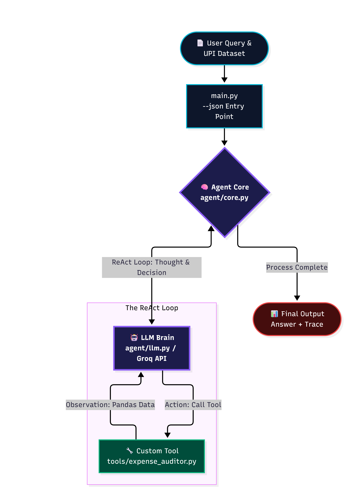

# 🤖 BillBuster: The Agentic Expense Auditor & Anomaly Hunter

**AgentX Challenge 2026 | Track: Finance & Risk**
**Team:** Innovators (AGX-16)

## 💡 The Problem
Traditional finance apps only show you a static pie chart of your spending. They don't take action. People waste thousands of rupees every month on duplicate charges, silent price hikes, and forgotten subscriptions.

## 🚀 The Solution: BillBuster
BillBuster is an **autonomous AI agent** that acts like a financial detective. It reads UPI transaction data, detects anomalies, explains its reasoning, and proposes a personalized, rebalanced budget plan to save you money.

### 🧠 The Agentic Loop
Unlike a standard script, BillBuster uses a genuine **ReAct (Thought → Action → Observation)** loop powered by the Groq API. It decides when to use its custom Python tool, observes the Pandas data output, and generates a final human-readable report and a machine-readable JSON trace.

---

## 🏗️ System Architecture



**Workflow:**
1. **Input:** User Query & `upi_transactions_2024.csv`.
2. **Agent Core:** The LLM Brain evaluates the query and decides to call the custom tool.
3. **Action:** The `expense_auditor.py` tool scans 10,000 rows using Pandas to find same-day duplicates and spend surges (amounts > 3x the category average).
4. **Observation:** The tool returns the anomalies to the LLM.
5. **Output:** The agent formulates a rebalanced budget plan and outputs the strict JSON contract.

---

## 🛠️ Tech Stack
* **Backend:** Python, Pandas, Groq API (LLM), Official AgentX ReAct Template.
* **Frontend:** Streamlit (for visualizing the Thought Trace and Final Report).
* **Data:** Kaggle UPI Transactions Dataset.

---

## 💻 How to Run (For Judges)

1. **Install dependencies:**
   ```bash
   pip install -r requirements.txt
